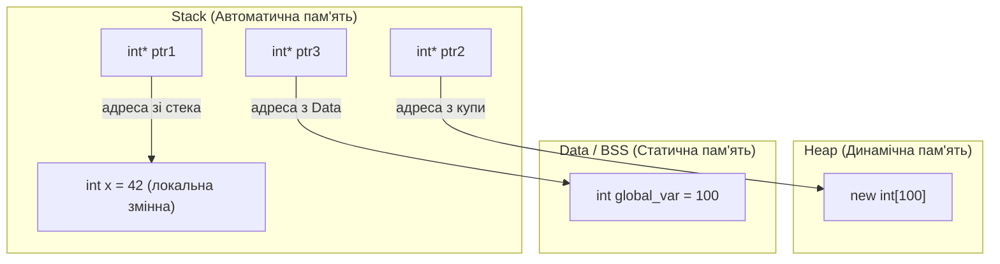
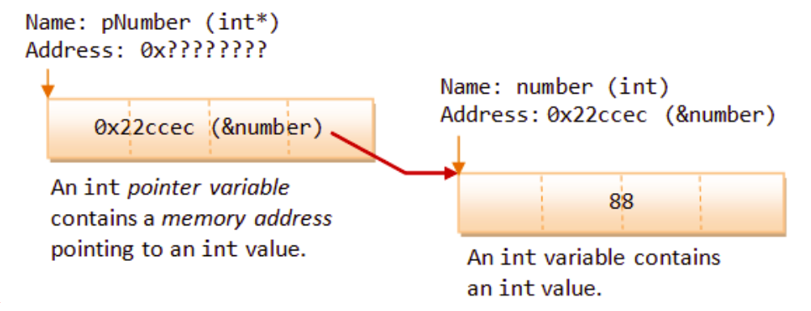

> **Дисклеймер / Disclaimer**  
> Авторська декларація: Базовий контент, концепцію та архітектуру цього курсу розроблено автором на основі власних лекцій та презентацій. Інструменти штучного інтелекту (LLM) використано виключно як технічний засіб для конвертації форматів (Slides → Markdown) та розгортання текстових тез. Увесь підсумковий текст, архітектурні схеми та код повністю вичитано, верифіковано та затверджено автором.

# Лекція 6: Вказівники (Pointers) в C++

## 🏁 Експрес-опитування

Вказівники тісно пов'язані з тим, як C++ працює з оперативною пам'яттю. Пригадаймо ключові концепції з попередньої лекції:

1. Що таке «функція» і яка її головна перевага?
2. Чим відрізняється глобальна змінна від локальної? Де «живе» кожна з них?
3. Що таке `int main()`? Це звичайна функція?
4. Коли функція завершує роботу, що відбувається з її локальними змінними?

<details markdown="1">
<summary>Натисніть, щоб переглянути відповіді</summary>

1. **Функція** — це іменований блок коду, який можна багаторазово викликати з інших частин програми. Її переваги: декомпозиція складних задач за принципом **«розділяй та володарюй»** та дотримання принципу **DRY (Don't Repeat Yourself)**.
2. **Глобальна змінна** оголошується поза межами всіх функцій і доступна звідусіль протягом усього часу виконання програми (сегмент даних). **Локальна змінна** оголошується всередині функції (або блоку `{}`) і доступна лише в межах своєї області видимості. Вона створюється на **стеку викликів (call stack)**.
3. Так, `int main()` — це точка входу (головна функція програми), з якої операційна система починає її виконання.
4. Вони **знищуються**, а виділена під них пам'ять у **стековому кадрі (stack frame)** автоматично звільняється. Це фундаментальний момент, до якого ми повертатимемося щоразу під час аналізу адрес пам'яті.

</details>

-----

## Що таке вказівник і навіщо він потрібен?

**Вказівники (Pointers)**, **посилання (References)** та **динамічне виділення пам'яті** — це базові можливості C++, що надають розробнику прямий контроль над оперативною пам'яттю комп'ютера. Саме цей контроль забезпечує граничну швидкість і ресурсоефективність, якими славиться C++.

Водночас вказівники вважаються однією з найскладніших для опанування тем. Роботу з ними влучно порівнюють із **«зарядженим пістолетом у руках новачка»**:

* **Потужність:** вказівники дозволяють напряму звертатися до будь-якої доступної комірки пам'яті та модифікувати її вміст.
* **Складність:** вони вимагають від програміста граничної уваги до типів, меж пам'яті та часу життя об'єктів.
* **Ризики:** недбале використання веде до витоків пам'яті (memory leaks), пошкодження даних, аварійних падінь програми (Segmentation Fault) та серйозних уразливостей безпеки.

Сучасні високорівневі мови (на кшталт Java чи C#) свідомо приховують прямі вказівники за механізмом автоматичного керування пам'яттю. Проте для розробника на C++ розуміння вказівників є базовим професійним фундаментом.

### ❓ Питання до групи

Чому мови на кшталт Java чи C# вирішили приховати прямі вказівники від розробника? Який компроміс було обрано: що саме вони віддали і що отримали натомість?

<details markdown="1">
<summary>Натисніть, щоб переглянути відповідь</summary>
Це класичний інженерний компроміс: **«Продуктивність проти Безпеки»**. Розробники цих платформ обміняли *прямий низькорівневий контроль над пам'яттю* (і максимальну швидкодію C++) на *безпеку середовища* та *простоту розробки*. Автоматичне збирання сміття (Garbage Collection) значно зменшує ризик витоків пам'яті, проте вносить додаткові накладні витрати ресурсів і недетерміновані паузи під час виконання.
</details>

-----

## Пам'ять комп'ютера: Адреси та дані

Щоб опанувати вказівники, важливо уявити фізичну та логічну організацію оперативної пам'яті (RAM). Її можна розглядати як суцільну довгу послідовність пронумерованих комірок розміром 1 байт:

* Кожна комірка має унікальний числовий номер — **адресу** (яка зазвичай записується в шістнадцятковому форматі: `0x7ffd...`).
* Кожна комірка зберігає певне двійкове значення — **дані**.

Змінні, які ми оголошуємо в програмі, займають одну або кілька таких послідовних комірок. Тип даних (`int`, `double`, `char`) вказує компілятору, скільки саме байтів виділити для змінної та як інтерпретувати двійковий код, записаний у них.

| Комп'ютер | | Програміст | | |
| :--- | :--- | :--- | :--- | :--- |
| **Адреса** | **Вміст (Hex)** | **Ім'я** | **Тип** | **Значення** |
| `0x90000000` | `00` | | | |
| `0x90000001` | `00` | `sum` | `int` (4 байти) | `0x000000FF` (255) |
| `0x90000002` | `00` | | | |
| `0x90000003` | `FF` | | | |
| `0x90000004` | `FF` | `age` | `short` (2 байти) | `0xFFFF` (-1) |
| `0x90000005` | `FF` | | | |
| ... | ... | | | |
| `0x9000000E` | `90` | `ptrSum` | `int*` (вказівник)* | `0x90000000` |
| `0x9000000F` | `00` | | | |
| `0x90000010` | `00` | | | |
| `0x90000011` | `00` | | | |

> [!NOTE]
> \* У наведеній спрощеній схемі для наочності проілюстровано 32-бітну модель, де адреса займає 4 байти. У сучасних 64-бітних операційних системах адреса та вказівник мають розмір 8 байтів (64 біти), проте фундаментальний принцип зберігання залишається тим самим.

**Вказівник — це спеціальна змінна, яка зберігає не звичайне прикладне значення (число, символ тощо), а адресу іншої комірки пам'яті.**

### Карта оперативної пам'яті процесу (Memory Layout)

Коли скомпільована програма на C++ завантажується в оперативну пам'ять, операційна система виділяє їй власний віртуальний адресний простір, який традиційно поділяється на чотири основні сегменти:

```text
Високі адреси (0x7FFF... / 0xFFFF...)
┌───────────────────────────────────────────────┐
│              СТЕК (Stack)                     │ ◄── Локальні змінні, параметри функцій,
│        (зростає вниз: ▼ до менших адрес)      │     адреси повернення (stack frames)
├───────────────────────────────────────────────┤
│                      │                        │
│                      ▼                        │
│             Вільна пам'ять                    │
│                      ▲                        │
│                      │                        │
├───────────────────────────────────────────────┤
│              КУПА (Heap)                      │ ◄── Динамічна пам'ять (виділяється через
│        (зростає вгору: ▲ до більших адрес)    │     оператор new або malloc)
├───────────────────────────────────────────────┤
│        СЕГМЕНТ ДАНИХ (Data / BSS)             │ ◄── Глобальні та static змінні
│  (ініціалізовані та неініціалізовані змінні)  │     (живуть весь час виконання програми)
├───────────────────────────────────────────────┤
│         СЕГМЕНТ КОДУ (Text / Code)            │ ◄── Машинні інструкції програми
│             (тільки для читання)              │     (код main та інших функцій)
└───────────────────────────────────────────────┘
Низькі адреси (0x0000...)
```

| Сегмент пам'яті | Що там зберігається? | Час життя (Lifetime) | Керування пам'яттю |
| :--- | :--- | :--- | :--- |
| **Stack (Стек)** | Локальні змінні функцій, аргументи, адреси повернення. | Лише під час виконання функції (блоку `{}`). | **Автоматичне** (апаратне зміщення вказівника стека при вході та виході з функції). |
| **Heap (Купа)** | Об'єкти та масиви, створені динамічно (`new int[100]`). | Доки програміст явно не викличе `delete` (або до завершення процесу). | **Ручне** (керується програмістом або «розумними вказівниками»). |
| **Data / BSS** | Глобальні змінні (`int global_x;`) та статичні змінні (`static`). | Протягом **усього часу** виконання програми. | **Статичне** (виділяється операційною системою під час завантаження програми). |
| **Text (Код)** | Скомпільований двійковий машинний код інструкцій. | Протягом усього часу виконання програми. | **Тільки для читання** (захищений ОС від випадкової або шкідливої модифікації). |

> [!IMPORTANT]
> **Чому це критично для розуміння вказівників:**  
> Вказівник — це числове значення адреси байта в пам'яті. Тому вказівник може зберігати адресу комірки **з будь-якого сегмента пам'яті**:
> * `int *p1 = &localVar;` — вказує на комірку в сегменті **Stack**;
> * `int *p2 = &globalVar;` — вказує на комірку в сегменті **Data**;
> * `int *p3 = new int(42);` — вказує на комірку в сегменті **Heap**;
> * `void (*pFunc)() = &myFunc;` — вказівник на функцію, вказує в сегмент **Text**.



-----

## Робота з вказівниками

### Оголошення вказівників

Вказівник оголошується за допомогою символу зірочки `*`. Кожен вказівник завжди суворо прив'язаний до типу даних, на який він вказує:

```cpp
// Синтаксис:
// тип_даних *ім'я_вказівника;

int *iPtr;    // iPtr — вказівник на ціле число (зберігає адресу змінної типу int)
double *dPtr; // dPtr — вказівник на число з плаваючою комою (адреса double)
```

**«Пастка C++» при груповому оголошенні:**

Символ `*` у граматиці C++ синтаксично прив'язується не до типу даних, а до конкретного імені змінної:

```cpp
int* p1, p2;  // УВАГА: p1 — це вказівник на int, АЛЕ p2 — це звичайний int!
int *p1, *p2; // ПРАВИЛЬНО: і p1, і p2 є вказівниками на int.
```

З цієї причини в практиці розробки на C++ склалися два поширені підходи:
1. `int* p1;` — підкреслює, що типом змінної є «вказівник на int» (найпопулярніший у сучасному C++, але вимагає правила: *одне оголошення на рядок*).
2. `int *p1;` — наочно демонструє синтаксичну прив'язку зірочки до ідентифікатора змінної (успадковано з класичного C).

**Рекомендація щодо найменування:** До імені вказівника зазвичай додають префікс `p` або суфікс `Ptr` (наприклад, `pNumber`, `numberPtr`, `pTotal`), що суттєво полегшує читання коду.

### Оператор взяття адреси `&`

Щоб отримати адресу наявної змінної, використовують унарний **оператор взяття адреси `&` (address-of operator)**. Результат цієї операції присвоюється змінній-вказівнику:

```cpp
int number = 88;       // Звичайна змінна типу int
int *pNumber;          // Оголошення вказівника на int
pNumber = &number;     // Присвоєння адреси змінної 'number' вказівнику 'pNumber'

// Оголошення та ініціалізацію можна об'єднати:
int *pAnother = &number;
```



### Оператор розіменування `*`

Сам по собі вказівник зберігає лише числову адресу (наприклад, `0x7ffd9a8b1234`). Щоб дістатися до значення, що зберігається за цією адресою, використовують унарний **оператор розіменування `*` (dereference operator)**:

```cpp
#include <iostream>
using namespace std;

int main() {
    int number = 88;
    int *pNumber = &number;

    // Читання значень:
    cout << "Адреса в pNumber: " << pNumber << endl;   // Виведе шістнадцяткову адресу number
    cout << "Значення за адресою: " << *pNumber << endl; // Виведе 88 (значення комірки)

    // Зміна значення через вказівник:
    *pNumber = 99; // Записати число 99 у комірку, на яку вказує pNumber

    cout << "Нове значення через *pNumber: " << *pNumber << endl; // Виведе 99
    cout << "Значення оригінальної змінної: " << number << endl;   // Також виведе 99!
    return 0;
}
```

### ❓ Питання до групи

Символ `*` використовується у двох абсолютно різних контекстах:
1. Оголошення: `int *ptr;`
2. Розіменування: `*ptr = 99;`

А тепер порівняйте: `*pNumber = 99;` та `number = 99;`. Обидва записи приводять до однакового результату — число 99 записується в комірку пам'яті змінної `number`. Навіщо взагалі потрібен запис `*pNumber`, якщо можна напряму написати `number = 99;`? Де вказівники стають незамінними?

<details markdown="1">
<summary>Натисніть, щоб переглянути відповідь</summary>
Це критично необхідно, коли **інша функція повинна змінити нашу змінну**. За замовчуванням у C++ аргументи у функцію передаються за значенням (pass-by-value), тобто створюється ізольована копія даних. Змінити оригінал у такий спосіб неможливо. Проте ми можемо передати у функцію *адресу* нашої змінної (`&number`). Функція, отримавши адресу у вказівник `pNumber`, розіменовує його через `*pNumber` і напряму змінює оригінал у нашому стековому кадрі. Цей механізм називається **передачею за вказівником (pass-by-pointer)**.
</details>

-----

## LHS та RHS: Ліва та Права сторони виразів

Щоб вільно орієнтуватися у вказівних операціях і не припускатися грубих помилок, фундаментально важливо розуміти різницю між **LHS (Left-Hand Side)** та **RHS (Right-Hand Side)** відносно оператора присвоєння (`=`):

```text
    LHS         =         RHS;
(куди писати)         (що писати)
  Локатор               Значення
```

### RHS (Права сторона) — Сторона значення (Source / Value)

**Призначення:** права сторона виразу завжди **обчислюється (evaluated) до конкретного значення**. Це джерело даних.

**Чим може виступати RHS:**
* **Літералом:** `x = 10;` (RHS — константа `10`)
* **Змінною:** `x = y;` (RHS — поточне значення змінної `y`)
* **Арифметичним виразом:** `x = y + z * 2;` (RHS — результат обчислення виразу)
* **Викликом функції:** `x = getArea(5.0);` (RHS — значення, повернене функцією)
* **Оператором взяття адреси `&`:** `ptr = &x;` (RHS — обчислена адреса комірки `x`)
* **Оператором розіменування `*`:** `val = *ptr;` (RHS — зчитане значення з адреси `ptr`)

> [!NOTE]
> **Чому `&x` може стояти ТІЛЬКИ в RHS?**  
> Операція `&x` повертає числовий результат — адресу пам'яті. Адреса є тимчасовим обчисленим значенням (rvalue). Її не можна розглядати як комірку пам'яті, куди дозволено щось записати: вирази `&x = ptr;` або `&x = 0x7ffd...;` є грубою синтаксичною помилкою компіляції.

### LHS (Ліва сторона) — Сторона локатора пам'яті (Destination / Locator)

**Призначення:** ліва сторона визначає **конкретне місце в пам'яті (локатор / lvalue)**, куди буде збережено результат обчислення правої сторони.

**Чим може виступати LHS (у операціях із вказівниками):**
* **Звичайною змінною:** `x = 10;` (запис у комірку змінної `x`)
* **Самим вказівником:** `ptr = &y;` (запис нової адреси в комірку самого вказівника `ptr`)
* **Розіменованим вказівником:** `*ptr = 30;` (запис значення у комірку пам'яті, на яку дивиться `ptr`)
* **Елементом масиву:** `arr[0] = 20;` (запис за адресою елемента масиву)

> **Аналогія з поштовою скринькою:** LHS — це конкретна адреса поштової скриньки, куди листоноша кладе лист. Ви можете покласти лист у скриньку №4 (`x = ...`), але не можете надіслати лист «у відповідь на приклад 2 + 2» (`x + y = 10` — синтаксично неприпустимо).

### Підсумкова таблиця ролей

| Конструкція | У ролі LHS (Ліва частина `=`) | У ролі RHS (Права частина `=`) |
| :--- | :--- | :--- |
| `x` | `x = 10;` (зміна значення `x`) | `val = x;` (читання значення `x`) |
| `ptr` | `ptr = &y;` (перенаправлення вказівника на іншу адресу) | `otherPtr = ptr;` (копіювання адреси в інший вказівник) |
| `*ptr` | `*ptr = 42;` (запис числа 42 у цільову пам'ять) | `val = *ptr;` (читання значення з цільової пам'яті) |
| `&x` | ❌ **Заборонено:** `&x = ...;` (адреса не є коміркою запису) | `ptr = &x;` (взяття адреси для збереження) |

-----

## Правила безпеки та типові помилки

### 1. Сувора типізація вказівників

У мові C++ вказівники є строго типізованими. Вказівник на `int` може зберігати виключно адресу змінної типу `int`, а вказівник на `double` — виключно адресу `double`. Це гарантує, що при розіменуванні компілятор прочитає або запише правильну кількість байтів згідно з форматом типу.

```cpp
int i = 88;
double d = 55.66;

int *iPtr = &i;     // OK: типи збігаються
// iPtr = &d;       // ПОМИЛКА КОМПІЛЯЦІЇ: не можна присвоїти double* до int*
// iPtr = i;        // ПОМИЛКА КОМПІЛЯЦІЇ: вказівник зберігає адресу, а не число
```

### 2. Неініціалізовані («дикі») вказівники (Wild Pointers)

Оголошення вказівника без одночасної ініціалізації є критично небезпечним:

```cpp
int *iPtr;   // НЕБЕЗПЕЧНО: iPtr містить випадкову адресу зі стека («пам'ятне сміття»)
*iPtr = 55;  // КАТАСТРОФА: спроба записати число 55 за випадковою невідомою адресою!
```

Наслідки виконання такого коду непередбачувані: від аварійної зупинки ОС (Segmentation Fault) до непомітного спотворення сусідніх даних у пам'яті програми. Це класичний приклад **невизначеної поведінки (Undefined Behavior)**.

### 3. Нульові вказівники (Null Pointers)

Якщо вказівник оголошено, але він ще не має конкретної адреси для зберігання, його обов'язково слід ініціалізувати нульовим значенням:

```cpp
int *p1 = 0;        // Застарілий стиль мови C
int *p2 = NULL;     // Стиль C з використанням макроса NULL
int *p3 = nullptr;  // Сучасний, безпечний та рекомендований стандарт C++11
```

> [!TIP]
> **Чому `nullptr` кращий за `NULL` та `0`?**  
> `nullptr` має власний незалежний тип `std::nullptr_t`. На відміну від цілочисельного нуля або макроса `NULL` (який розгортається в число `0`), `nullptr` не можна випадково сплутати з цілим числом `int` при перевантаженні функцій.

Спроба розіменувати нульовий вказівник (`*p3`) гарантовано викличе негайне завершення процесу операційною системою, що значно полегшує налагодження програми порівняно з «тихим» пошкодженням пам'яті через дикий вказівник. Перед кожним розіменуванням сумнівного вказівника завжди додавайте перевірку:

```cpp
if (ptr != nullptr) {
    *ptr = 42;
}
```

-----

## Керування доступом: `const` та вказівники

Ключове слово `const` дозволяє розмежувати незмінність самих даних і незмінність адреси у вказівнику. Комбінація `const` та `*` дає чотири фундаментальні моделі доступу.

> [!TIP]
> ### Золоте правило читання: справа наліво (Right-to-Left Rule)
> Читайте складні оголошення строго від імені змінної **справа наліво**:
>
> ```text
> int const * const ptr;
>       ^   ^   ^    ^
>       |   |   |    +-- 1. ptr — це...
>       |   |   +------- 2. константний (const)...
>       |   +----------- 3. вказівник (*)...
>       +--------------- 4. на константне ціле число (int const)
> ```

> [!NOTE]
> **East Const vs West Const:**  
> Оголошення `const int *ptr` (West Const) та `int const *ptr` (East Const) є **абсолютно еквівалентними** для компілятора. Модифікатор `const` завжди стосується елемента ліворуч від нього; якщо ж ліворуч нічого немає (як у `const int`), він діє на елемент праворуч. Стиль East Const (`int const *`) вважається більш послідовним, оскільки дозволяє читати будь-який вираз справа наліво без винятків.

---

### Чотири комбінації доступу

#### 1. `int* ptr` — Звичайний неконстантний вказівник
* **Як читати:** `ptr` — це вказівник (`*`) на змінне число `int`.
* **Дозволено:** можна змінювати і значення за адресою (`*ptr = 9;`), і саму адресу у вказівнику (`ptr = &other;`).
* **Приклад:**
  ```cpp
  int a = 1, b = 2;
  int* ptr = &a;
  *ptr = 10;   // OK: змінено значення 'a'
  ptr = &b;    // OK: вказівник перенаправлено на 'b'
  ```

#### 2. `const int* ptr` (або `int const* ptr`) — Вказівник на константу
* **Як читати:** `ptr` — це вказівник (`*`) на незмінне ціле число (`const int`).
* **Суть:** вказівник гарантує, що дані за адресою будуть доступні **лише для читання**. Сама змінна може бути звичайною, але через цей вказівник змінити її неможливо.
* **Дозволено:** перенаправляти вказівник на іншу комірку (`ptr = &b;`).
* **Заборонено:** змінювати значення через розіменування (`*ptr = 10;` // Помилка компіляції!).
* **Застосування:** передача великих буферів або рядків у функцію без права модифікації.

#### 3. `int* const ptr` — Константний вказівник
* **Як читати:** `ptr` — це константний (`const`) вказівник (`*`) на змінне ціле число (`int`).
* **Суть:** адреса у вказівнику зафіксована раз і назавжди. Його **обов'язково** потрібно ініціалізувати в момент створення!
* **Дозволено:** змінювати значення за адресою (`*ptr = 10;`).
* **Заборонено:** перенаправляти вказівник на іншу адресу (`ptr = &b;` // Помилка компіляції!).
* **Зв'язок із посиланнями:** саме так концептуально влаштовані посилання в C++ (докладно розглянемо в [Лекції 7](07_references.md#що-таке-посилання-під-капотом-under-the-hood)).

#### 4. `const int* const ptr` — Константний вказівник на константу
* **Як читати:** `ptr` — це константний (`const`) вказівник (`*`) на константне ціле число (`const int`).
* **Суть:** заблоковано абсолютно будь-які зміни: адреса зафіксована, а дані доступні лише для читання.
* **Заборонено:** ані `ptr = &b;`, ані `*ptr = 10;` не скомпільовуються.

---

### Зведена матриця доступу

| Оголошення | Чи можна змінити адресу (`ptr = &b`)? | Чи можна змінити дані (`*ptr = 42`)? | Обов'язкова ініціалізація? | Типовий сценарій |
| :--- | :---: | :---: | :---: | :--- |
| `int* ptr` | Так | Так | Ні | Звичайні змінні, динамічні буфери |
| `const int* ptr`<br>*(або `int const* ptr`)* | **Так** | ❌ **Ні** | Ні | Функції читання даних без копіювання |
| `int* const ptr` | ❌ **Ні** | **Так** | **Так** | Фіксовані буфери, апаратні регістри вводу-виводу |
| `const int* const ptr` | ❌ **Ні** | ❌ **Ні** | **Так** | Абсолютно незмінні конфігураційні дескриптори |

-----

## Вказівники на функції (Function Pointers)

Код програми після компіляції також розміщується в оперативній пам'яті — у сегменті `.text`. Кожна функція є послідовністю машинних інструкцій за певною базовою адресою.

> **Важливий принцип:** ім'я функції (без круглих дужок) є адресою її першої інструкції в пам'яті!

### Синтаксис оголошення вказівника на функцію

Вказівник на функцію повинен точно знати її повну сигнатуру:
1. Тип значення, що повертається.
2. Кількість, порядок та типи вхідних аргументів.

```cpp
#include <iostream>
using namespace std;

int add(int a, int b) {
    return a + b;
}

int multiply(int a, int b) {
    return a * b;
}

int main() {
    // Дужки (*pOperation) обов'язкові!
    // Без них запис int* pOperation(int, int) компілятор сприйме як прототип функції,
    // яка повертає вказівник int*.
    int (*pOperation)(int, int) = nullptr;

    pOperation = add; // або &add (оператор & для функцій є необов'язковим)
    cout << "5 + 3 = " << pOperation(5, 3) << endl; // виклик add через вказівник: 8

    pOperation = multiply;
    cout << "5 * 3 = " << pOperation(5, 3) << endl; // виклик multiply через вказівник: 15

    return 0;
}
```

### Застосування: функції зворотного виклику (Callbacks)

Вказівники на функції дозволяють передавати одну функцію як аргумент усередину іншої. Це основа гнучких та розширюваних алгоритмів:

* **Математичні обчислення:** універсальна функція інтегрування `integrate(double (*f)(double), double a, double b)` здатна обчислити визначений інтеграл для будь-якої переданої функції (`sin`, `cos`, квадратичної тощо).
* **Сортування:** алгоритми на кшталт `qsort` чи функції впорядкування приймають функцію-компаратор, яка порівнює два елементи за довільним критерієм.

> [!NOTE]
> У сучасному C++ для роботи з функціональними об'єктами частіше використовують лямбда-вирази та `std::function`, проте класичні вказівники на функції залишаються швидким низькорівневим механізмом, спільним для C та C++.

-----

## Шпаргалка: символи `*` та `&` у різних контекстах

Одна з головних причин початкової плутанини при вивченні C++ — подвійне та потрійне значення символів `*` і `&`. Їхня дія принципово залежить від того, чи стоять вони в **оголошенні типу**, чи у **виразі над змінними**.

| Символ | Контекст | Роль | Що означає? | Приклад | Читається як |
| :---: | :--- | :--- | :--- | :--- | :--- |
| `*` | **У типі** (оголошення) | Специфікатор типу | Оголошує змінну-вказівник | `int *ptr;` | *«ptr — це вказівник на int»* |
| `*` | **У виразі** (перед вказівником) | Унарний оператор розіменування | Перехід за адресою: читання або запис значення | `*ptr = 42;`<br>`cout << *ptr;` | *«Записати 42 за адресою в ptr»* /<br>*«Дістати значення за адресою ptr»* |
| `*` | **У виразі** (між змінними) | Бінарний оператор | Арифметичне множення | `int s = a * b;` | *«a помножити на b»* |
| `&` | **У типі** (оголошення) | Специфікатор типу | Оголошує посилання ([Лекція 7](07_references.md)) | `int &ref = x;` | *«ref — це посилання на x (інше ім'я для x)»* |
| `&` | **У виразі** (перед змінною) | Унарний оператор взяття адреси | Повертає адресу комірки пам'яті | `ptr = &x;` | *«Взяти адресу комірки x»* |
| `&` | **У виразі** (між змінними) | Бінарний оператор | Побітове «І» (Bitwise AND) | `int m = a & 0xFF;` | *«Побітове І між a та 0xFF»* |

> [!TIP]
> **Золоте правило для розрізнення:**
> * Якщо перед `*` чи `&` стоїть **тип даних** (`int* ptr`, `double& ref`) — це **оголошення** (створення вказівника або посилання).
> * Якщо `*` чи `&` стоїть перед **вже наявною змінною** у виразі (`*ptr = 5`, `&x`) — це **операція з пам'яттю** (розіменування або взяття адреси).

-----

## Контрольні питання

1. **Концепція.** Поясніть принципову різницю між змінною-вказівником та звичайною змінною. Що саме зберігає кожна з них?
2. **Аналіз коду.** Що буде виведено на екран у результаті виконання фрагмента програми? Поясніть призначення та значення кожного з виразів: `&x`, `ptr` та `*ptr`.

   ```cpp
   #include <iostream>
   using namespace std;

   int main() {
       int x = 10;
       int *ptr = &x;
       *ptr = 20;

       cout << "Address of x: " << &x << endl;
       cout << "Value of ptr: " << ptr << endl;
       cout << "Value pointed to by ptr: " << *ptr << endl;
       cout << "Value of x: " << x << endl;
       return 0;
   }
   ```

3. **Пошук помилок.** Знайдіть дві грубі помилки в наведеному коді. Поясніть, чим вони загрожують роботі програми:

   ```cpp
   int *pValue;
   *pValue = 100;

   double pi = 3.14;
   pValue = &pi;
   ```

4. **Практичне завдання.** Оголосіть змінну `double price = 19.99;` та вказівник `pPrice`, який дивиться на неї. Потім, використовуючи **лише вказівник `pPrice`**, змініть значення `price` на `24.99`.

<details markdown="1">
<summary>Натисніть, щоб переглянути відповіді</summary>

**1. Вказівник vs Звичайна змінна:**
* **Звичайна змінна** (наприклад, `int x = 10;`) безпосередньо зберігає прикладне значення даних (число 10).
* **Змінна-вказівник** (наприклад, `int *ptr = &x;`) зберігає числову адресу комірки оперативної пам'яті, де розміщено інший об'єкт (наприклад, `0x7ffd...`).

**2. Аналіз результату виконання:**
На екран буде виведено (числові значення адрес змінюються під час кожного запуску):
```text
Address of x: 0x7ffd12345678
Value of ptr: 0x7ffd12345678
Value pointed to by ptr: 20
Value of x: 20
```
* `&x`: оператор взяття адреси; повертає адресу розташування змінної `x` у стековому кадрі.
* `ptr`: змінна-вказівник; зберігає та виводить ту саму адресу `x`.
* `*ptr`: операція розіменування; звертається за адресою `ptr` і повертає значення `20`, яке було туди записане командою `*ptr = 20;`.
* `x`: оригінальна змінна; оскільки `*ptr` модифікував саму комірку `x`, значення `x` тепер також дорівнює `20`.

**3. Помилки в коді:**
* **Помилка 1:** `int *pValue; *pValue = 100;`. Вказівник `pValue` є неініціалізованим («диким»). Він містить випадкову адресу пам'яті. Спроба записати туди число 100 веде до невизначеної поведінки (Undefined Behavior) та ймовірного аварійного збою програми (Segmentation Fault).
* **Помилка 2:** `pValue = &pi;`. Вказівник має тип `int*`, тоді як змінна `pi` має тип `double`. C++ — строго типізована мова, тому присвоєння адреси `double` цілочисельному вказівнику заборонено компілятором без явного приведення типів.

**4. Практичне завдання (зміна через вказівник):**
```cpp
double price = 19.99;
double *pPrice = &price; // 1. Оголошення та ініціалізація адресою price

*pPrice = 24.99;        // 2. Зміна значення за адресою через оператор розіменування (*)
```

</details>

---

## Джерела

- [Реєстр технічних джерел](sources.md) — ISO/IEC 14882:2020 (`[dcl.ptr]`), cppreference.com
