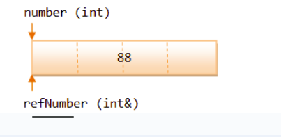
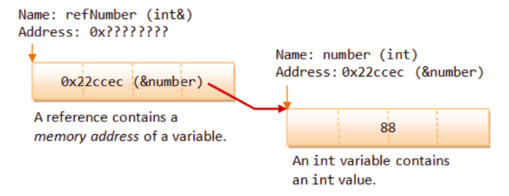

> **Дисклеймер / Disclaimer**  
> Авторська декларація: Базовий контент, концепцію та архітектуру цього курсу розроблено автором на основі власних лекцій та презентацій. Інструменти штучного інтелекту (LLM) використано виключно як технічний засіб для конвертації форматів (Slides → Markdown) та розгортання текстових тез. Увесь підсумковий текст, архітектурні схеми та код повністю вичитано, верифіковано та затверджено автором.

# Лекція 7: Посилання (References) та передача параметрів у функції

## 🏁 Експрес-опитування

У попередній лекції ми познайомилися з потужним, але ризикованим інструментом — вказівниками. Перевірмо, як засвоєно ключові концепції, перш ніж перейти до їхньої безпечної та елегантної альтернативи:

1. Якщо оголошено `int x = 10;`, що поверне вираз `&x`?
2. Якщо оголошено `int *ptr = &x;`, що поверне вираз `*ptr`?
3. У чому полягає головна небезпека неініціалізованого («дикого») вказівника (наприклад, `int *p; *p = 10;`)?
4. Яке позначення нульового вказівника є рекомендованим у сучасному C++ (`0`, `NULL` чи `nullptr`) і чому?

<details markdown="1">
<summary>Натисніть, щоб переглянути відповіді</summary>

1. Оператор взяття адреси `&` поверне **числову адресу** комірки змінної `x` в оперативній пам'яті (наприклад, `0x7ffd...`).
2. Оператор розіменування `*` поверне **значення**, що зберігається за цією адресою, тобто число `10`.
3. Виникає **невизначена поведінка (Undefined Behavior)**. Вказівник `p` містить випадкову адресу зі стека («сміття»), і спроба записати число `10` у довільну комірку пам'яті призводить до пошкодження даних або аварійного завершення програми (Segmentation Fault).
4. **`nullptr`**. Це ключове слово та типізований літерал (введений у C++11 типу `std::nullptr_t`), який виключає плутанину з цілими числами при перевантаженні функцій на відміну від застарілих `0` та макроса `NULL`.

</details>

-----

## Що таке посилання (Reference)?

**Посилання (Reference)** — це фундаментальна можливість C++, яка створює **псевдонім (alias)** або альтернативне ім'я для *вже наявної* змінної. Після створення посилання ви можете звертатися до тієї самої комірки пам'яті, використовуючи як оригінальне ім'я, так і ім'я-псевдонім.

> [!TIP]
> ### Життєва аналогія: паспортне ім'я та псевдонім
> Уявіть студента: за паспортом він *Олександр*, а друзі кличуть його *Сашко*. Скільки тут фізичних людей? **Одна людина**.  
> Якщо *Сашко* отримає оцінку — оцінку отримає *Олександр*. Посилання в C++ працює точно так само: це не окрема комірка зі значенням, а ще одна табличка з ім'ям на тих самих дверях комірки пам'яті.

Основне практичне призначення посилань — застосування у ролі параметрів функцій для реалізації механізму **передачі за посиланням (pass-by-reference)** та повернення результатів без копіювання.



### Що таке посилання «під капотом» (Under the Hood)?

Для компілятора та апаратного забезпечення посилання — це не магія, а чітко визначена системна модель:

> **Апаратна сутність:** На рівні компілятора посилання зазвичай реалізується як **константний вказівник (`Type* const`)**, який компілятор автоматично розіменовує під час кожного звернення.

Пригадайте категорію 3 з [Лекції 6: Константний вказівник](06_pointers.md#3-int-const-ptr--константний-вказівник) — адреса у `ptr` фіксується раз і назавжди, але значення за адресою змінювати дозволено. Погляньте на повну еквівалентність логіки:

```cpp
int a = 10;

// Синтаксис C++ (посилання):
int& ref = a;
ref = 20;            // звертаємося напряму як до змінної

// Як компілятор реалізує це «під капотом» через вказівник:
int* const ptr = &a; // адреса зафіксована раз і назавжди
*ptr = 20;           // авто-розіменування під час кожного звернення
```

Завдяки такій конструкції ми отримуємо **всі переваги низькорівневої швидкості вказівників (пряма робота з пам'яттю оригіналу), але без небезпеки помилитися із зірочками `*`, амперсандами `&` або натрапити на `nullptr`**.

---

### Подвійне значення символу `&`

Як ми вже з'ясували у зведеній [шпаргалці Лекції 6](06_pointers.md#шпаргалка-символи--та--у-різних-контекстах), символ `&` в C++ має два принципово різні значення залежно від **контексту**:

* **В оголошеннях (у типі даних):** специфікатор типу, що оголошує **посилання**. Наприклад, `int& refNumber = number;` (`refNumber` — це псевдонім).
* **У виразах (перед змінною):** унарний оператор **взяття адреси**. Наприклад, `&number` повертає числову адресу комірки пам'яті.

**Синтаксис оголошення посилання:**

```cpp
// newName стає новим ім'ям (псевдонімом) для existingName
Тип& newName = existingName;
```

**Приклад:**

```cpp
int number = 10;
int& refNumber = number; // refNumber — це інше ім'я для 'number'

refNumber = 20;          // Це змінює оригінальну змінну 'number' на 20!
cout << number;          // Виведе 20
```



> [!NOTE]
> **Стилі оформлення: `Type& ref` проти `Type &ref`**  
> Як і у випадку з вказівниками, символ `&` можна ставити поруч із типом (`int& ref`) або біля імені (`int &ref`). У сучасному C++ для посилань стандартом де-факто є стиль `int& ref`, оскільки посилання сприймається саме як частина сигнатури типу («посилання на int»).

-----

## Посилання проти вказівників (References vs Pointers)

Хоча під капотом посилання та вказівники оперують адресами оперативної пам'яті, на рівні мови C++ між ними існують принципові концептуальні та синтаксичні відмінності:

| Критерій | Вказівник (`*`) | Посилання (`&`) |
| :--- | :--- | :--- |
| **Ініціалізація** | Може бути неініціалізованим («диким»). Може бути ініціалізований `nullptr`. | **Обов'язково** має бути ініціалізоване реальною змінною в момент створення. |
| **Зміна зв'язку (Re-binding)** | Можна перенаправити на іншу комірку (`ptr = &another;`). | **Неможливо переприв'язати.** Нерозривно пов'язане зі своєю змінною протягом усього часу життя. |
| **Синтаксис доступу** | Вимагає **явного розіменування** через `*` (`*ptr = 10;`). | Працює як звичайна змінна: розіменовується **автоматично** (`ref = 10;`). |
| **Null-безпека** | Може зберігати `nullptr`. Потребує регулярної перевірки `if (ptr != nullptr)`. | **Не може бути `null`**. Гарантовано дивиться на валідний об'єкт у пам'яті. |
| **Адресна арифметика** | Підтримує адресні операції зміщення (`ptr++`, `ptr + 5`). | Арифметики посилань **не існує** (вираз `ref++` інкрементує значення змінної). |

### ❓ Питання до групи

Чому творець C++ Б'ярн Страуструп (Bjarne Stroustrup) та комітет мови додали посилання, якщо в мові вже були повноцінні вказівники?

<details markdown="1">
<summary>Натисніть, щоб переглянути відповідь</summary>
Посилання вирішують дві фундаментальні інженерні задачі:

1. **Безпека коду:** посилання не можуть бути неініціалізованими і не можуть дорівнювати `nullptr`. Це усуває левову частку аварійних падінь програм через невалідні адреси.
2. **Чистота синтаксису (особливо для перевантаження операторів):** запис `ref = 10;` набагато природніший і чистіший за `*ptr = 10;`. Без посилань було б неможливо елегантно реалізувати потоки введення-виведення: наприклад, замість звичного `cin >> x;` програмістам довелося б писати громіздке `cin >> &x;`.
</details>

-----

## Передача параметрів у функції

Головне практичне призначення посилань у повсякденній практиці C++ — оптимізація виклику функцій.

### Мотивація: як повернути з функції більше одного значення?

Оператор `return` у C++ дозволяє повернути лише **одне** значення. Що робити, якщо функція повинна обчислити й передати викликачу два або три результати?  
Класичний приклад — ділення цілих чисел з остачею (де потрібно отримати одночасно частку і остачу):

```cpp
#include <iostream>
using namespace std;

// Використання посилань для вихідних параметрів (out-parameters):
void divide(int dividend, int divisor, int& quotient, int& remainder) {
    quotient = dividend / divisor;
    remainder = dividend % divisor;
}

int main() {
    int q = 0, r = 0;
    divide(17, 5, q, r);
    cout << "Частка: " << q << ", Остача: " << r << endl; // Частка: 3, Остача: 2
    return 0;
}
```

---

### Три способи передачі аргументів

#### 1. За значенням (Pass-by-Value)
* **Що відбувається:** створюється повна незалежна **копія** даних у стековому кадрі викликаної функції.
* **Ефект:** зміни всередині функції відбуваються виключно з локальною копією і **не зачіпають оригінал**.
* **Коли використовувати:** для малих скалярних типів (`int`, `double`, `char`, `bool`, розмір яких не перевищує 8 байтів).
* **Недолік:** вкрай неефективно для великих об'єктів (довгі рядки `std::string`, масиви, структури, вектори `std::vector`), оскільки дублювання мегабайтів пам'яті різко сповільнює роботу.

#### 2. За вказівником (Pass-by-Pointer) — *Спадщина мови C*
* **Що відбувається:** у функцію передається числова копія адреси змінної (розмір 8 байтів).
* **Синтаксис:** вимагає символу `*` у параметрі функції та взяття адреси `&` під час виклику: `func(&myVar)`.
* **Коли використовувати:** лише коли аргумент є **опціональним**, тобто коли функція передбачає можливість передати `nullptr` (відсутність даних).

#### 3. За посиланням (Pass-by-Reference) — *Ідіоматичний C++*
* **Що відбувається:** створюється псевдонім оригінальної змінної (без копіювання!). Функція працює безпосередньо з оригінальною пам'яттю викликача.
* **Синтаксис:** абсолютно чистий, як при передачі за значенням: `func(myVar)`.
* **Коли використовувати:** коли функція повинна змінити передану змінну (вихідні параметри) або коли передається великий об'єкт.

-----

## Безпека та ефективність: `const Type&`

Поєднання модифікатора `const` із передачею за посиланням формує найважливішу та найпопулярнішу ідіому сучасного C++:

```cpp
void printMessage(const std::string& message);
```

Цей запис декларує чіткий контракт:  
*«Я передаю об'єкт за посиланням, щоб **не витрачати процесорний час і пам'ять на копіювання**, але гарантую компілятору, що функція **не змінюватиме його вміст** завдяки специфікатору `const`»*.

### ⚡ Критична властивість: прив'язка до rvalue (літералів та виразів)

У новачків часто виникає запитання: навіщо писати `const Type&`, якщо можна просто передавати `Type&`?

> [!WARNING]
> **Неконстантне посилання (`Type&`) НЕ МОЖЕ прив'язуватися до літералів, констант і тимчасових результатів виразів (rvalue)!**

Порівняйте поведінку компілятора:

```cpp
#include <iostream>
using namespace std;

void badPrint(int& x) {
    cout << x << endl;
}

void goodPrint(const int& x) {
    cout << x << endl;
}

int main() {
    int val = 10;
    badPrint(val);        // OK: val — це повноцінна іменована змінна (lvalue)
    
    // badPrint(42);      // ПОМИЛКА КОМПІЛЯЦІЇ! Число 42 — це тимчасовий літерал (rvalue).
    // badPrint(val + 5); // ПОМИЛКА КОМПІЛЯЦІЇ! Результат обчислення val + 5 — тимчасовий об'єкт.

    goodPrint(42);       // ВІДМІННО! Успішно скомпілюється.
    goodPrint(val + 5);  // ВІДМІННО! Успішно скомпілюється.
    return 0;
}
```

**Чому встановлено таке правило?**  
Стандарт C++ забороняє зв'язувати неконстантні посилання з тимчасовими об'єктами, щоб захистити розробника від безглуздих логічних помилок (якби функція модифікувала `x`, зміна тимчасового значення `42` або `val + 5` не мала б жодного сенсу і була б втрачена).  
Проте для **константного посилання (`const Type&`)** компілятор робить фундаментальний виняток: він створює приховану тимчасову змінну і **подовжує її час життя (lifetime extension)** на весь період виконання викликаної функції.

> [!TIP]
> **Золоте архітектурне правило вибору параметрів функцій у C++:**
> 1. Базові скалярні типи (`int`, `double`, `char`, `bool`) передавайте **за значенням** (`int x`).
> 2. Складні об'єкти (`std::string`, `std::vector`, структури, класи), які функція повинна лише читати, передавайте **за константним посиланням** (`const std::string& s`).
> 3. Змінні, значення яких функція повинна модифікувати як результат своєї роботи (вихідні параметри), передавайте **за неконстантним посиланням** (`int& outResult`).
> 4. Якщо аргумент може бути відсутній взагалі, використовуйте вказівник (`int* optPtr = nullptr`).

-----

## Зведена матриця: вибір способу передачі аргументів

| Спосіб передачі | Синтаксис | Чи є копіювання? | Чи змінює оригінал? | Чи приймає вирази та літерали (`42`, `a + b`)? | Рекомендований сценарій |
| :--- | :--- | :---: | :---: | :---: | :--- |
| **За значенням (by value)** | `void f(int x)` | Так | Ні | Так | Малі типи (1–8 байтів): `int`, `double`, `char`, `bool` |
| **За неконстантним посиланням** | `void f(int& x)` | **Ні** | **Так** | ❌ **Ні** | Вихідні параметри функції (out-parameters) |
| **За константним посиланням** | `void f(const Big& x)` | **Ні** | Ні | **Так** | Усі складні типи: `string`, вектори, структури (Read-Only) |
| **За вказівником** | `void f(int* x)` | Лише копія адреси (8 байтів) | **Так** | ❌ (потрібен `&` або вказівник) | Опціональні параметри (де допустимий `nullptr`) |

-----

## Повернення значень за посиланням

Функції в C++ можуть не лише приймати посилання як аргументи, але й повертати посилання як результат своєї роботи (`int& func()`).  
Це дозволяє результату виклику функції бути повноцінним **lvalue** (тобто розташовуватися з лівого боку від оператора присвоєння `=`). Такий механізм є основою роботи багатьох перевантажених операторів (наприклад, оператора індексації масиву `[]` або ланцюжків потоків `cout << a << b`):

```cpp
#include <iostream>
using namespace std;

int arr[5] = {10, 20, 30, 40, 50}; // Глобальний масив (живе весь час програми)

int& getElement(int index) {
    return arr[index]; // повертаємо посилання на комірку глобального масиву
}

int main() {
    getElement(2) = 999; // Звернення функцією у ролі LHS! Змінює arr[2] на 999
    cout << arr[2];      // Виведе 999
    return 0;
}
```

### ⚠️ Критична помилка: висячі посилання (Dangling References) та стек

> **Категорично заборонено повертати посилання або вказівник на локальну змінну функції!**

Пригадаймо [Карту оперативної пам'яті процесу](06_pointers.md#карта-оперативної-памяті-процесу-memory-layout) з попередньої лекції:

```text
Стек під час виконання badFunction():
┌───────────────────────────────────────────────┐
│ [localVar = 10]                               │ ◄── Стековий кадр badFunction (Stack Frame)
└───────────────────────────────────────────────┘
                      │
                      ▼ після виконання оператора return:
Стековий кадр badFunction ЗНИЩУЄТЬСЯ (вказівник стека зміщується, пам'ять звільняється).
Посилання продовжує посилатися на цю вже «мертву» область пам'яті!
```

Погляньте на типову катастрофічну помилку:

```cpp
// КРИТИЧНО ПОМИЛКОВИЙ КОД:
int& badFunction() {
    int localVar = 10;
    return localVar; // ПОМИЛКА: повернення посилання на локальну змінну зі стека!
}

int main() {
    int& ref = badFunction(); // 'ref' є висячим посиланням (Dangling Reference)
    // 'ref' дивиться на пам'ять, яка вже звільнена і буде перезаписана
    // першим же наступним викликом будь-якої іншої функції!
    cout << ref << endl;      // Невизначена поведінка (Undefined Behavior)!
    return 0;
}
```

**Правило безпеки:** Повертати результат за посиланням можна лише тоді, коли об'єкт гарантовано продовжує жити після завершення функції (наприклад, це глобальна змінна, статичний об'єкт, динамічно виділений об'єкт у купі або об'єкт, переданий у функцію за посиланням іззовні). Якщо функція обчислює новий локальний результат — повертайте його **виключно за значенням** (`int badFunction()`). Завдяки оптимізаціям сучасних компіляторів (RVO / NRVO — Return Value Optimization) повернення за значенням не створить зайвих копій.

-----

## Контрольні питання

1. **Концепція.** Назвіть дві принципові відмінності між вказівником та посиланням у C++.
2. **Застосування.** Що таке «передача за посиланням» (pass-by-reference)? Які переваги вона забезпечує порівняно з «передачею за значенням» (pass-by-value) при роботі з великими структурами даних?
3. **Аналіз коду.** Знайдіть критичну логічну помилку в наведеній функції. Поясніть, чому цей код призведе до аварійного стану або некоректних даних:

   ```cpp
   int& getSomeValue() {
       int temp = 5;
       temp += 10;
       return temp;
   }
   ```

4. **Проєктування прототипу.** Напишіть прототип функції `processUserData`, яка приймає великий об'єкт типу `std::string` з іменем `userData` тільки для читання (без права на зміну) та цілочисельний лічильник `errorCounter` типу `int`, значення якого функція повинна збільшувати під час роботи. Використовуйте найбільш ефективний та безпечний спосіб передачі параметрів.

<details markdown="1">
<summary>Натисніть, щоб переглянути відповіді</summary>

**1. Вказівник vs Посилання:**
* **Ініціалізація та зміна адреси:** посилання обов'язково має бути прив'язане до реальної змінної при створенні й не може бути переприв'язане на іншу змінну. Вказівник можна залишати неініціалізованим, ініціалізувати `nullptr` та вільно перенаправляти на інші адреси в процесі роботи.
* **Синтаксис та безпека:** посилання розіменовується автоматично (працює за синтаксисом звичайної змінної) і гарантовано не є `null`. Вказівник вимагає явного оператора розіменування `*` та перевірки на `nullptr`.

**2. Pass-by-Reference:**
* Це спосіб передачі аргументів у функцію, при якому параметр стає псевдонімом (прямим посиланням) оригінальної змінної викликача без створення копії в пам'яті.
* **Переваги:**
  1. **Максимальна продуктивність:** усувається дорога операція виділення пам'яті та копіювання байтів (особливо для великих рядків, масивів, структур або векторів).
  2. **Пряма модифікація:** дозволяє функції повертати результати через вихідні параметри, напряму змінюючи оригінальні змінні.

**3. Помилка у функції:**
* **Суть помилки:** функція повертає посилання на локальну змінну `temp`.
* **Наслідки:** змінна `temp` має автоматичну тривалість зберігання і розміщується в стековому кадрі функції `getSomeValue`. Після виконання оператора `return` функція завершує роботу, її стековий кадр анулюється, а пам'ять змінної `temp` звільняється. Повернене посилання стає **висячим (dangling reference)**. Будь-яке звернення до нього викликає невизначену поведінку (Undefined Behavior).

**4. Прототип функції:**
```cpp
void processUserData(const std::string& userData, int& errorCounter);
```
* **Пояснення:**
  * `const std::string& userData`: передача за константним посиланням запобігає витратному копіюванню довгого рядка і на рівні компілятора гарантує, що функція не змінить вхідні дані.
  * `int& errorCounter`: передача за неконстантним посиланням дозволяє функції модифікувати оригінальний лічильник викликача без створення локальної копії.

</details>

---

## Джерела

- [Реєстр технічних джерел](sources.md) — ISO/IEC 14882:2020 (`[dcl.ref]`), cppreference.com
