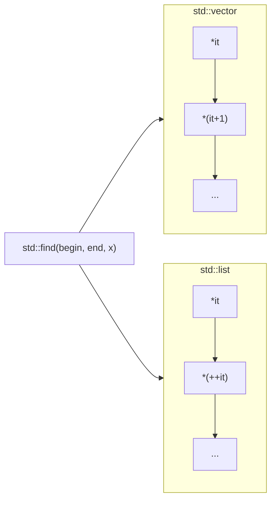
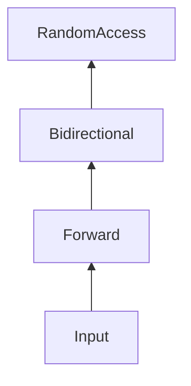

> **Дисклеймер / Disclaimer**  
> Авторська декларація: Базовий контент, концепцію та архітектуру цього курсу розроблено автором на основі власних лекцій та презентацій. Інструменти штучного інтелекту (LLM) використано виключно як технічний засіб для конвертації форматів (Slides → Markdown) та розгортання текстових тез. Увесь підсумковий текст, архітектурні схеми та код повністю вичитано, верифіковано та затверджено автором.

# Лекція 20a: Ітератори та діапазони (Ranges)

[← Лекція 20](20_lists_vector.md) | [Index](index.md) | [Далі: Лекція 20b →](20b_adt_stack_queue.md)

---

## Мета

Після лекції студент зможе:

- Пояснити, що таке ітератор і чим він відрізняється від індексу.
- Використовувати `begin()` / `end()` з контейнерами STL.
- Застосовувати алгоритми `<algorithm>` з ітераторами замість ручних циклів.
- Орієнтуватися в категоріях ітераторів (input, forward, bidirectional, random access).

## Передумови

- [Лекція 20: Vector vs List](20_lists_vector.md)

---

## Частина 1: Навіщо потрібні ітератори?

У [Лекції 20](20_lists_vector.md) ми побачили, що `std::vector` підтримує доступ за індексом (`vec[i]`), а `std::list` — ні. Як тоді написати **один** алгоритм пошуку для обох контейнерів?

**Ітератор** — це уніфікований «вказівник на елемент контейнера», який абстрагує спосіб обходу.



---

## Частина 2: begin() та end()

Кожен контейнер STL надає пару ітераторів:

| Вираз | Значення |
|-------|----------|
| `c.begin()` | Ітератор на **перший** елемент |
| `c.end()` | Ітератор на позицію **після останнього** (sentinel) |

> **Важливо:** цикл `for (auto it = v.begin(); it != v.end(); ++it)` ніколи не розіменовує `end()` — це лише межа діапазону.

```cpp
#include <iostream>
#include <vector>
#include <list>
#include <algorithm>

template<typename Container>
void print(const Container& c) {
    for (auto it = c.begin(); it != c.end(); ++it) {
        std::cout << *it << ' ';
    }
    std::cout << '\n';
}

int main() {
    std::vector<int> v{3, 1, 4, 1, 5};
    std::list<int>  l{9, 2, 6};

    print(v);
    print(l);

    auto found = std::find(v.begin(), v.end(), 4);
    if (found != v.end()) {
        std::cout << "Знайдено: " << *found << '\n';
    }
}
```

---

## Частина 3: Range-based for (C++11) та C++20 ranges

Синтаксичний цукор над ітераторами:

```cpp
for (const auto& item : container) { /* ... */ }
// Еквівалентно:
for (auto it = container.begin(); it != container.end(); ++it) {
    const auto& item = *it;
}
```

У C++20 з'явився заголовок `<ranges>`:

```cpp
#include <ranges>
#include <vector>
#include <iostream>

int main() {
    std::vector<int> v{1, 2, 3, 4, 5, 6};
    for (int x : v | std::views::filter([](int n) { return n % 2 == 0; })) {
        std::cout << x << ' ';  // 2 4 6
    }
}
```

---

## Частина 4: Категорії ітераторів

| Категорія | Операції | Приклад контейнера |
|-----------|----------|-------------------|
| Input | `++it`, `*it`, read-once | `istream_iterator` |
| Forward | input + multi-pass | `forward_list` |
| Bidirectional | forward + `--it` | `list`, `map`, `set` |
| Random Access | bidirectional + `it+n`, `it[n]` | `vector`, `deque` |

Чим «сильніша» категорія — тим більше алгоритмів доступно та тим швидше вони працюють.



---

## Частина 5: Алгоритми STL

Замість ручного циклу — стандартний алгоритм:

```cpp
#include <algorithm>
#include <vector>
#include <numeric>

std::vector<int> data{5, 2, 8, 1, 9};

std::sort(data.begin(), data.end());

int sum = std::accumulate(data.begin(), data.end(), 0);

auto it = std::lower_bound(data.begin(), data.end(), 5);
// data вже відсортовано — бінарний пошук O(log N)
```

---

## ❓ Питання до групи

1. Чому `end()` не вказує на останній елемент?
2. Чи можна використати `std::sort` з `std::list`? Чому?

<details markdown="1">
<summary>Відповідь</summary>

1. Порожній контейнер має `begin() == end()`. Якщо б `end()` вказував на останній елемент, для порожнього контейнера не існувала б коректна «порожня» позиція, і універсальний цикл `it != end()` ускладнився б.
2. Ні. `std::sort` вимагає Random Access Iterator (`it + n`), а `list` надає лише Bidirectional. Для списку — `list.sort()` (вбудований merge sort).

</details>

---

## Контрольні питання

1. Що повертає `*it` для ітератора `it`?
2. Назвіть різницю між ітератором `vector` та `list` щодо арифметики `it + 5`.
3. Який заголовок потрібен для `std::find`?

## Зв'язок з практикумом

- [Практикум 12: Performance Lab](p12_performance_lab.md)
- [Практикум 14: Search Engine](p14_search_engine.md)

---

## Джерела

- [^cppref] [Iterator library](https://en.cppreference.com/w/cpp/iterator) — ISO/IEC 14882:2020, `[iterator]`
- [^cppref] [Algorithm library](https://en.cppreference.com/w/cpp/algorithm) — `[algorithms]`
- [Реєстр технічних джерел](../sources.md)
