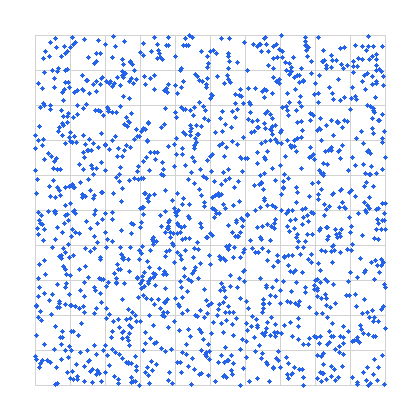
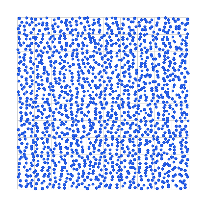

> **Дисклеймер / Disclaimer**  
> Авторська декларація: Базовий контент, концепцію та архітектуру цього курсу розроблено автором на основі власних лекцій та презентацій. Інструменти штучного інтелекту (LLM) використано виключно як технічний засіб для конвертації форматів (Slides → Markdown) та розгортання текстових тез. Увесь підсумковий текст, архітектурні схеми та код повністю вичитано, верифіковано та затверджено автором.

# Практикум 9: Розподіл Пуассона — чи бомбили Лондон прицільно?

[← Практикум 8](p08_fstream.md) | [Index](index.md)

-----

## Історія

У 1944–1945 роках на Лондон падали **V-1** — німецькі **«літаючі бомби»** з крилами та пульсуючим двигуном (*buzz bomb*; це **не** балістична ракета на кшталт V-2). Лондонці прозвали їх **«жужжачими»**: двигун видавав характерне **брррр** — і поки цей звук чувся, бомба ще летіла. Коли мотор **замовкав**, вона **починала падати**. Секунди тиші були найстрашнішими.

Серед мешканців ходила думка: *«вони б'ють прицільно — це не випадковість»*.

**Яке питання треба було перевірити?** Чи справді німці **бомбили прицільно** — чи удари були **випадковими**, і око лише здавалося, що бачить ціль?

-----

## Частина 1: Чи можна довіряти оку?

Перш ніж рахувати по реальних даних, варто запитати: **чи взагалі ми надійні спостерігачі?**

Подивіться на дві карти однакового розміру. На обох — однакова кількість точок.

| Карта A | Карта B |
| :---: | :---: |
|  |  |

### ❓ Питання до групи

**Яка з двох карт виглядає як випадковий розподіл?**

<details markdown="1">
<summary>Відповідь</summary>

**Карта A — випадкова.** При випадковому розкиді точок кластери й порожні плями **обов'язково** з'являться — це не доказ прицілу.

**Карта B — невипадкова (стратифікована).** Ті самі **1500** точок, але по одній у кожній мікрозоні сітки 30×50 — виглядає щільно й рівномірно, **без щільних скупчень**, яких дає справжня випадковість.

Саме тому лондонці могли клястися, що «бомблять прицільно»: око бачить кластери на кшталт карти A і сприймає їх як доказ прицілу. Але це ще **не доводить** приціл — треба перевірити статистично.

</details>

-----

## Частина 2: Як перевірив Clarke

Актуарій **R. D. Clarke** (1946) узяв питання з історії вище і перевірив його по даних. Він обрав ділянку **144 км²** Південного Лондона з приблизно однаковою щільністю ударів і розбив її на **576 квадратів** по 0,25 км². За обраний період — **537** влучень.

**Наступне питання:** якщо бомби падали **випадково**, скільки квадратів мало б отримати 0, 1, 2, 3… влучень? І чи збігається це з тим, що він **спостеріг** насправді?

-----

## Частина 3: Формула Пуассона

Щоб відповісти, потрібна модель. Якщо рідкісні незалежні події відбуваються зі середньою інтенсивністю **λ** на одиницю площі (тут — на один квадрат), то ймовірність отримати рівно **k** подій:

$$
P(k) = \frac{\lambda^k \cdot e^{-\lambda}}{k!}
$$

| Символ | Значення |
| :--- | :--- |
| **k** | кількість ударів у одному квадраті (0, 1, 2, …) |
| **λ** | середня кількість ударів на квадрат |
| **k!** | факторіал k (0! = 1, 1! = 1, 2! = 2, 3! = 6, …) |
| **e** | число Ейлера ≈ 2,71828 (`exp()` у `<cmath>`) |

Для даних Clarke:

$$
\lambda = \frac{537}{576} \approx 0{,}932
$$

Очікувана кількість квадратів із **k** ударами:

$$
\text{очікувано}(k) = 576 \cdot P(k)
$$

У C++ (як у [`poisson.cpp`](https://github.com/vplanto/cpp/blob/main/00-intro/poisson.cpp)):

```cpp
double poissonProbability(double lambda, int k) {
  return (pow(lambda, k) * exp(-lambda)) / factorial(k);
}
```

-----

## Частина 4: Реальні дані (Clarke, 1946)

| k (бомб у квадраті) | Спостережено (квадратів) | Очікувано за Пуассоном |
| :---: | :---: | :---: |
| 0 | 229 | 226,74 |
| 1 | 211 | 211,39 |
| 2 | 93 | 98,54 |
| 3 | 35 | 30,62 |
| 4 | 7 | 7,14 |
| 5 і більше | 1 | 1,57 |
| **Разом** | **576** | **576** |

Числа «Очікувано» — з роботи **Clarke**; їх можна відтворити програмою.

-----

## Частина 5: Інженерний аудит наївної реалізації

Базова утиліта [`00-intro/poisson.cpp`](https://github.com/vplanto/cpp/blob/main/00-intro/poisson.cpp) обчислює $P(k)$ прямо за формулою:

```cpp
double poissonProbability(double lambda, int k) {
  return (pow(lambda, k) * exp(-lambda)) / factorial(k);
}
```

Для `k = 0..5` вона працює, але як підсумковий інженерний кейс має чотири обмеження:

1. **Переповнення `factorial(k)`.** Тип `long long` уміщує значення до $2^{63} - 1 \approx 9{,}22 \cdot 10^{18}$. Уже при $k = 21$ значення $21! \approx 5{,}1 \cdot 10^{19}$ переповнює `long long` і дає undefined behavior.
2. **Немає хвостової категорії `5+`.** Останній рядок таблиці Clarke об'єднує всі квадрати з $k \ge 5$, тобто $P(\ge 5) = 1 - \sum_{j=0}^{4} P(j)$, а не точкове $P(5)$.
3. **Захардкоджені вхідні дані.** Спостережені частоти не зчитуються з файлу, тому порівняння доводиться робити вручну.
4. **Немає статистичного вердикту.** Виведені ймовірності ще не дають критерію згоди $\chi^2$ Пірсона.

### Як прибрати факторіал: рекурентна схема

Замість обчислення $\lambda^k$ і $k!$ на кожному кроці використовуємо сусідні члени ряду:

$$
P(0) = e^{-\lambda}, \qquad P(k) = P(k - 1) \cdot \frac{\lambda}{k}
$$

Переваги рекуренти:
- складність обчислення $O(1)$ на один бін без `pow()` і без факторіала;
- немає цілочисельного переповнення при будь-якому розумному $k$;
- для хвостового біну `5+` імовірність рахується як залишок $1 - \sum_{j=0}^{4} P(j)$, тож сума $E_i$ гарантовано дорівнює $N = 576$.

---

## Частина 6: Підсумковий кейс (файли, структури, динамічна пам'ять)

Повна реалізація винесена в [`08-io/poisson_chi2.cpp`](https://github.com/vplanto/cpp/blob/main/08-io/poisson_chi2.cpp), а історичні дані Clarke - у [`08-io/clarke_1946.csv`](https://github.com/vplanto/cpp/blob/main/08-io/clarke_1946.csv).

### 1. Формат даних (`08-io/clarke_1946.csv`)

```csv
# Clarke, R. D. (1946), "An Application of the Poisson Distribution"
# South London V-1 flying-bomb impacts: 576 squares (0.25 km^2 each), 537 total hits.
# total_hits: 537
# label,k,is_tail,observed
0,0,0,229
1,1,0,211
2,2,0,93
3,3,0,35
4,4,0,7
5+,5,1,1
```

Зверніть увагу на деталь у даних Clarke: сума $\sum k \cdot O_k$ за формальними індексами $0..5$ дає $0\cdot 229 + 1\cdot 211 + 2\cdot 93 + 3\cdot 35 + 4\cdot 7 + 5\cdot 1 = 535$, тоді як реальна кількість влучень становить **537** (один квадрат із групи `5+` отримав 7 ударів). Саме тому `total_hits: 537` передається в заголовку файлу окремо.

### 2. Модель даних (`struct PoissonBin`) та динамічний масив

Кожен рядок таблиці описується однією структурою замість набору паралельних масивів:

```cpp
struct PoissonBin {
  std::string label; // "0", "1", ..., "5+"
  int k;
  bool isTail;       // true для хвостової категорії ("5+")
  int observed;      // O_i
  double expected;   // E_i = N * P_i
  double chi2Term;   // (O_i - E_i)^2 / E_i
};
```

Оскільки кількість рядків у файлі невідома на етапі компіляції, програма робить два проходи через `std::ifstream`:
1. `countDataRows()` рахує непусті некоментарні рядки (без використання пастки `while (!file.eof())` - лише `while (std::getline(file, line))`).
2. `PoissonBin* bins = new PoissonBin[binCount];` виділяє масив у купі, `loadBins()` парсить CSV через `std::stringstream`, а перед виходом з `main()` пам'ять звільняється через `delete[] bins; bins = nullptr;`.

---

## Частина 7: Критерій Пірсона ($\chi^2$) та об'єднання хвоста

Щоб перевірити узгодженість спостережених частот $O_i$ та очікуваних $E_i$, обчислюється статистика Пірсона:

$$
\chi^2 = \sum_{i=1}^{m} \frac{(O_i - E_i)^2}{E_i}
$$

### Навіщо об'єднувати хвостові категорії

Класичне правило застосовності критерію $\chi^2$ вимагає $E_i \ge 5$ у кожній категорії (інакше малий знаменник $E_i$ штучно роздуває внесок хвоста). У таблиці Clarke для категорії `5+` очікувана кількість становить $E_{5+} = 1{,}57 < 5$.

Функція `computeMergedChi2()` об'єднує останні категорії (`4` та `5+`) у спільний хвостовий бін `>= 4`:
- $O_{\ge 4} = 7 + 1 = 8$;
- $E_{\ge 4} = 7{,}14 + 1{,}57 = 8{,}71 \ge 5$;
- кількість категорій після об'єднання: $m = 5$;
- кількість ступенів свободи: $df = m - 1 - p = 5 - 1 - 1 = 3$ (один ступінь витрачено на нормування $\sum E_i = N$, ще один - на оцінку параметра $\lambda$ з тих самих даних).

### Результат запуску програми

```text
Дані Clarke (1946): квадратів = 576, влучень = 537, lambda = 0.9323

k           Observed    Expected     (O-E)^2/E
----------------------------------------------
0                229      226.74          0.02
1                211      211.39          0.00
2                 93       98.54          0.31
3                 35       30.62          0.63
4                  7        7.14          0.00
5+                 1        1.57          0.21

chi^2 (усі 6 категорій) = 1.1692
chi^2 (об'єднаний хвіст E >= 5: останній бін O=8, E=8.71) = 1.0176, df = 3
Критичне значення (alpha = 0.05, df = 3) = 7.815
Висновок: підстав відхилити гіпотезу випадкового розподілу Пуассона немає.
```

---

## Завдання на практикум

1. **Базовий запуск (для порівняння):** зберіть і запустіть [`00-intro/poisson.cpp`](https://github.com/vplanto/cpp/blob/main/00-intro/poisson.cpp) із $\lambda = 537/576 \approx 0{,}932292$. Переконайтесь, що для $k = 0..4$ значення збігаються, а для $k = 5$ формула дає точкове $P(5)$, а не хвіст $P(\ge 5)$.
2. **Підсумковий кейс:** зберіть і запустіть [`08-io/poisson_chi2.cpp`](https://github.com/vplanto/cpp/blob/main/08-io/poisson_chi2.cpp) із санітайзером пам'яті:
   ```bash
   g++ -std=c++23 -Wall -Wextra -Werror -fsanitize=address,undefined 08-io/poisson_chi2.cpp -o poisson_chi2
   ./poisson_chi2 08-io/clarke_1946.csv
   ```
3. **Модифікація:** передайте у функцію `printTable(const PoissonBin* bins, int count)` виведення стовпця з індивідуальною ймовірністю $P(k) = E_i / N$ у відсотках (з точністю до `0.01%`) та запишіть підсумкову таблицю у новий файл `clarke_report.txt` через `std::ofstream`.

---

## Контрольні питання

1. Чому рекурента $P(k) = P(k-1) \cdot \lambda / k$ надійніша за `(pow(lambda, k) * exp(-lambda)) / factorial(k)`? При якому $k$ переповниться `long long factorial(int)`?
2. Чому в `loadBins()` і `countDataRows()` використано цикл `while (std::getline(file, line))`, а не `while (!file.eof())`?
3. Чому масив `bins` передається у `computePoissonExpectations()` як `PoissonBin*`, а у `printTable()` та `computeMergedChi2()` як `const PoissonBin*`?
4. Чому `df` у критерії $\chi^2$ дорівнює $m - 2$ ($5 - 2 = 3$), а не $m - 1$?
5. Що станеться у `loadBins()`, якщо забути викликати `delete[] bins;` перед виходом із `main()` (або при ранньому `return 1`)?

<details markdown="1">
<summary>Відповіді</summary>

1. Уникнення `pow()` та факторіала прибирає цілочисельне переповнення: `21! > 2^63 - 1`, тому `long long` переповнюється вже на $k = 21$.
2. Прапор `eof()` ставиться тільки після спроби читання за межею файлу, тому `while (!file.eof())` повторює обробку останнього рядка двічі.
3. `computePoissonExpectations()` змінює поля `expected` і `chi2Term` усередині елементів масиву, тоді як `printTable()` і `computeMergedChi2()` працюють лише на читання - `const` захищає дані від випадкової модифікації.
4. Один ступінь свободи втрачається через фіксовану суму спостережень ($\sum O_i = \sum E_i = N$), другий - через те, що параметр $\lambda$ оцінено з тієї самої вибірки, а не заданий апріорі.
5. Виникне витік пам'яті (memory leak) у купі (`Heap`), що виявить AddressSanitizer (`LeakSanitizer`).

</details>

-----

## Висновок

Спостережені та очікувані частоти практично збігаються ($\chi^2 = 1{,}0176 \ll 7{,}815$ при $df = 3$, $\alpha = 0{,}05$). Clarke (1946) показав, що дані **добре узгоджуються** з моделлю випадкового розподілу Пуассона - **немає статистичних підстав** стверджувати про прицільне бомбардування кластерів.

> **Нюанс:** випадковий процес Пуассона **обов'язково дає кластери** (як карта A вище). Інженерне питання полягає не в тому, «чи є скупчення на карті», а в тому, «чи перевищує їх кількість і щільність очікування випадкової моделі».


## Джерела

- [^clarke1946] R. D. Clarke, *An Application of the Poisson Distribution*, Journal of the Institute of Actuaries, 1946, 72:481.
- [^spiegelhalter2019] S. Spiegelhalter & H. Masters, *The Flying Bomb and the Actuary*, Significance, 2019.
- [Реєстр технічних джерел](sources.md) — ISO/IEC 14882:2020, `<cmath>` (`exp`, `pow`)
