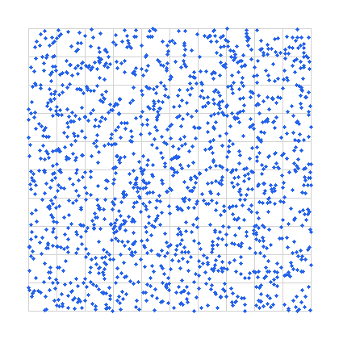
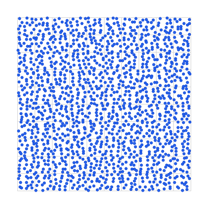

# Практикум 9: Розподіл Пуассона — чи бомбили Лондон прицільно?

[← Практикум 8](p08_fstream.md) | [Index](index.md)

-----

## Історія

У 1944–1945 роках на Лондон падали **V-1** — німецькі **«літаючі бомби»** з крилами та пульсуючим двигуном (*buzz bomb*; це **не** балістична ракета на кшталт V-2). Лондонці прозвали їх **«жужжачими»**: двигун видавав характерне **брррр** — і поки цей звук чувся, бомба ще летіла. Коли мотор **замовкав**, вона **починала падати**. Секунди тиші були найстрашнішими.

Серед мешканців ходила думка: *«вони б'ють прицільно — це не випадковість»*.

**Яке питання треба було перевірити?** Чи справді німці **бомбили прицільно** — чи удари були **випадковими**, і око лише здавалося, що бачить ціль?

-----

## Частина 1: Чи можна довіряти оку?

Перш ніж рахувати по реальних даних, варто запитати: **чи взагалі ми надійні спостерігачі?**

Подивіться на дві карти однакового розміру. На обох — однакова кількість точок.

| Карта A | Карта B |
| :---: | :---: |
|  |  |

### ❓ Питання до групи

**Яка з двох карт виглядає як випадковий розподіл?**

<details markdown="1">
<summary>Відповідь</summary>

**Карта A — випадкова.** При випадковому розкиді точок кластери й порожні плями **обов'язково** з'являться — це не доказ прицілу.

**Карта B — невипадкова (стратифікована).** Ті самі **1500** точок, але по одній у кожній мікрозоні сітки 30×50 — виглядає щільно й рівномірно, **без щільних скупчень**, яких дає справжня випадковість.

Саме тому лондонці могли клястися, що «бомблять прицільно»: око бачить кластери на кшталт карти A і сприймає їх як доказ прицілу. Але це ще **не доводить** приціл — треба перевірити статистично.

</details>

-----

## Частина 2: Як перевірив Clarke

Актуарій **R. D. Clarke** (1946) узяв питання з історії вище і перевірив його по даних. Він обрав ділянку **144 км²** Південного Лондона з приблизно однаковою щільністю ударів і розбив її на **576 квадратів** по 0,25 км². За обраний період — **537** влучень.

**Наступне питання:** якщо бомби падали **випадково**, скільки квадратів мало б отримати 0, 1, 2, 3… влучень? І чи збігається це з тим, що він **спостеріг** насправді?

-----

## Частина 3: Формула Пуассона

Щоб відповісти, потрібна модель. Якщо рідкісні незалежні події відбуваються зі середньою інтенсивністю **λ** на одиницю площі (тут — на один квадрат), то ймовірність отримати рівно **k** подій:

$$
P(k) = \frac{\lambda^k \cdot e^{-\lambda}}{k!}
$$

| Символ | Значення |
| :--- | :--- |
| **k** | кількість ударів у одному квадраті (0, 1, 2, …) |
| **λ** | середня кількість ударів на квадрат |
| **k!** | факторіал k (0! = 1, 1! = 1, 2! = 2, 3! = 6, …) |
| **e** | число Ейлера ≈ 2,71828 (`exp()` у `<cmath>`) |

Для даних Clarke:

$$
\lambda = \frac{537}{576} \approx 0{,}932
$$

Очікувана кількість квадратів із **k** ударами:

$$
\text{очікувано}(k) = 576 \cdot P(k)
$$

У C++ (як у [`poisson.cpp`](https://github.com/vplanto/cpp/blob/main/00-intro/poisson.cpp)):

```cpp
double poissonProbability(double lambda, int k) {
  return (pow(lambda, k) * exp(-lambda)) / factorial(k);
}
```

-----

## Частина 4: Реальні дані (Clarke, 1946)

| k (бомб у квадраті) | Спостережено (квадратів) | Очікувано за Пуассоном |
| :---: | :---: | :---: |
| 0 | 229 | 226,74 |
| 1 | 211 | 211,39 |
| 2 | 93 | 98,54 |
| 3 | 35 | 30,62 |
| 4 | 7 | 7,14 |
| 5 і більше | 1 | 1,57 |
| **Разом** | **576** | **576** |

Числа «Очікувано» — з роботи **Clarke**; їх можна відтворити програмою.

-----

## 🛠️ Завдання

Напишемо невелику утиліту [`poisson.cpp`](https://github.com/vplanto/cpp/blob/main/00-intro/poisson.cpp), яка обчислює **розподіл Пуассона**, і порівняємо з таблицею Clarke.

1. Зберіть і запустіть [`poisson.cpp`](https://github.com/vplanto/cpp/blob/main/00-intro/poisson.cpp).
2. Введіть `λ = 537/576` (≈ `0.93229167`).
3. Програма виведе:

   ```
   0 - ...
   1 - ...
   ...
   ```

4. Помножте кожне `P(k)` на **576** — отримаєте очікувану кількість квадратів.
5. Порівняйте з колонкою «Спостережено». Наскільки близькі ряди?

-----

## Висновок

Спостережені та очікувані частоти **дуже близькі**. Clarke показав, що дані **добре узгоджуються** з моделлю випадкового розподілу — **немає переконливих доказів** прицільного бомбардування кластерів.

> **Нюанс:** випадковий Пуассон **також дає кластери** (як карта A вище). Питання не «чи є групування», а «чи більше його, ніж передбачає випадковість».

## Джерела

- R. D. Clarke, *An Application of the Poisson Distribution*, Journal of the Institute of Actuaries, 1946, 72:481.
- S. Spiegelhalter & H. Masters, *The Flying Bomb and the Actuary*, Significance, 2019.
