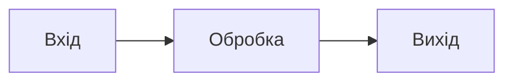

> **Дисклеймер / Disclaimer**  
> Авторська декларація: Базовий контент, концепцію та архітектуру цього курсу розроблено автором на основі власних лекцій та презентацій. Інструменти штучного інтелекту (LLM) використано виключно як технічний засіб для конвертації форматів (Slides → Markdown) та розгортання текстових тез. Увесь підсумковий текст, архітектурні схеми та код повністю вичитано, верифіковано та затверджено автором.

# Лекція N: Назва теми

[← Попередня](prev.md) | [Index](../index.md) | [Далі →](next.md)

---

## Мета заняття

Після лекції студент зможе:

- …
- …

## Передумови

- [Лекція N-1](prev.md)

---

## Теоретичний блок

### Підтема 1

Текст конспекту.

```cpp
// Приклад C++20
#include <iostream>
#include <string>

int main() {
    std::string msg{"Hello, C++!"};
    std::cout << msg << '\n';
}
```

### Діаграма (Mermaid)



---

## ❓ Питання до групи

1. …

<details markdown="1">
<summary>Відповідь</summary>

…

</details>

---

## Контрольні питання

1. …
2. …

## Зв'язок з практикумом

- [Практикум N](p0N_topic.md)

---

## Джерела

- [Реєстр технічних джерел](../sources.md)
- [^cppref] [cppreference.com](https://en.cppreference.com/w/)
